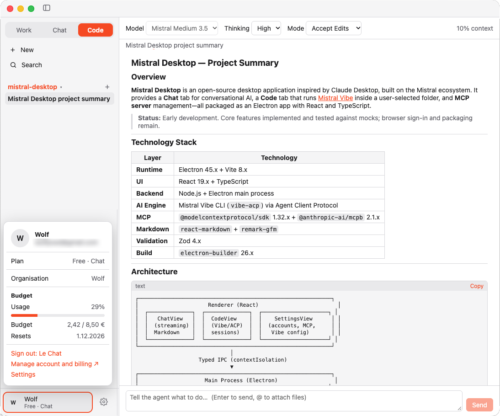

# Mistral Desktop

<p align="center">
  
</p>

**Mistral Desktop** is a free, open-source desktop application for macOS, Windows, and Linux. It brings the power of Mistral's AI to your local machine with a clean, native experience.

## What It Does

Mistral Desktop combines three powerful capabilities in one app:

| Feature | What it does |
|---------|--------------|
| **Chat** | Conversational AI with Mistral's latest models. Supports Markdown, code blocks, tables, and tool usage. |
| **Code** | Full-featured coding assistant powered by **Mistral Vibe** — run it in any project folder on your machine. |
| **MCP Servers** | Connect to Model Context Protocol servers — add tools, APIs, and custom integrations to supercharge both Chat and Code. |

Think of it as having a local AI coding partner that can also help you with any text-based task.

---

## Quick Start

### 1. Install

```bash
# Clone and set up
git clone https://github.com/wolfposd/mistral-desktop.git
cd mistral-desktop
npm install
```

### 2. Run in Development

```bash
npm run dev
```

### 3. Get an API Key

- Open **Settings** (⚙️ bottom-left)
- Go to **Account** → **Mistral API Key**
- Paste your Mistral API key (get one at [console.mistral.ai](https://console.mistral.ai))

*Alternatively:* Use the **Sign in with Mistral** button — the app can use Mistral Vibe's browser sign-in flow to get a key automatically.

### 4. Start Chatting

- Open the **Chat** tab
- Select a model from the dropdown
- Type your message and press Enter

### 5. Try Coding

- Open the **Code** tab
- Click **Open Folder** and select your project
- The app will start Mistral Vibe inside that folder
- Type `@` to autocomplete file names (e.g., `@src` finds `src/index.ts`)

---

## Features

### Chat Tab
- ✅ Streaming responses — see answers appear word-by-word
- ✅ Full Markdown support: code blocks with copy buttons, tables, lists
- ✅ Conversation history — pick up where you left off
- ✅ Model selection — choose from available Mistral models
- ✅ MCP tool integration — extend with custom capabilities

### Code Tab
- ✅ **Mistral Vibe Integration** — runs the official Vibe CLI (`vibe-acp`) as a subprocess
- ✅ Project folder selection — work in any directory on your machine
- ✅ Support for git worktrees - multiple agents same repository
- ✅ **@-mentions** — type `@` to autocomplete and attach files to your prompt
- ✅ File diffs — see changes before they're applied
- ✅ Permission prompts — approve or deny file edits and shell commands
- ✅ Session history — resume previous coding sessions
- ✅ MCP passthrough — your MCP servers are available to Vibe

### MCP Servers (Model Context Protocol)
Add capabilities to both Chat and Code:

- **Extensions (.mcpb)** — One-click install of pre-built MCP bundles. Secrets are stored securely in your OS keychain.
- **Local Servers** — Connect to any stdio-based MCP server on your machine.
- **Remote Servers** — Connect to HTTP/SSE MCP servers. Supports OAuth for secure authentication.

All MCP tools are available in Chat (with per-call approval) and passed through to Vibe in the Code tab.

---

## Settings

Click the **⚙️ Settings** button (bottom-left) to configure:

- **Account** — Mistral API key, Le Chat sign-in, Vibe configuration, `vibe-acp` path
- **Connectors** — Manage MCP extensions and servers
- **General** — App preferences, chat defaults, profile

---

## Requirements

| Component | Requirement |
|-----------|-------------|
| **Chat** | Mistral API key (or browser sign-in) |
| **Code** | [Mistral Vibe](https://github.com/mistralai/mistral-vibe) installed (`uv tool install mistral-vibe` or `brew install mistral-vibe`) |
| **MCP Extensions** | Python/uv or Node.js depending on the bundle |

---

## Learn More

- [Technical Details](docs/TECHNICAL.md) — Architecture, testing, known limitations, and implementation notes
- [PLAN.md](PLAN.md) — Design decisions, roadmap, and milestones
- [Mistral Vibe](https://github.com/mistralai/mistral-vibe) — The official Mistral coding agent
- [MCP Documentation](https://modelcontextprotocol.io) — Model Context Protocol specification

---

## License

MIT License — see [LICENSE](LICENSE) for details.

---

<p align="center">
  Built with Electron, React, TypeScript, and Mistral AI
</p>
